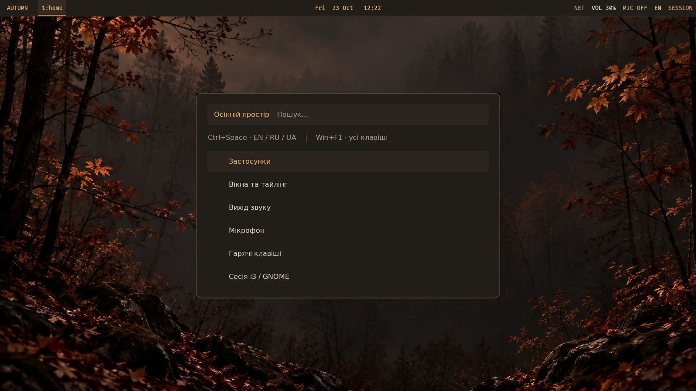

# Autumn — i3 + Polybar

[English](README.md) · **Українська**



Темний осінній робочий стіл для Debian 12: теплі мідні акценти, туманний ліс, компактна панель, українські меню, зручний тайлінг і окреме керування виходом звуку та мікрофоном. Підготовлено для i3 4.22, Polybar 3.6.3, Rofi 1.7.3, PipeWire/PulseAudio, GNOME Terminal, xss-lock та i3lock.

## Початок роботи

Увесь проєкт розміщений у `~/i3-autumn`. Єдиний установник:

```sh
cd ~/i3-autumn
./install.sh
```

Запускайте від свого користувача. Скрипт сам викличе `sudo` для встановлення відсутніх пакетів Debian, збере офіційний Picom 13 від звичайного користувача й встановить конфігурації з резервною копією. Для завантаження пакетів і вихідного коду потрібен інтернет. Пароль вводьте лише в запиті `sudo` у своєму терміналі.

Після встановлення збережіть роботу й вийдіть із GNOME звичайним способом. На екрані GDM виберіть користувача, у меню сесій із шестернею виберіть **i3** та увійдіть. Установник не завершує поточну сесію.

Натисніть **Win+C**, щоб відкрити центр керування, або **Win+F1**, щоб переглянути клавіші. Кнопка **AUTUMN** на панелі також відкриває центр керування.

## Клавіші

| Комбінація | Дія |
| --- | --- |
| Ctrl+Пробіл | Повернення на попередню мову (як у macOS), також у режимі зміни розміру |
| Ctrl+Alt+Пробіл | Мови по колу: EN → RU → UA → EN, також у режимі зміни розміру |
| Win+Enter | Термінал |
| Win+D / Win+Tab | Застосунки / відкриті вікна |
| Win+C / Win+F1 | Центр керування / довідка |
| Win+P | Меню звуку |
| Win+Ctrl+P | Вихід звуку |
| Win+Ctrl+Shift+P | Мікрофон |
| Win+стрілки | Фокус вікна |
| Win+Shift+стрілки | Перемістити вікно |
| Win+H / Win+V | Горизонтальний / вертикальний поділ |
| Win+W / Win+S / Win+E | Вкладки / стос / змінити напрям поділу |
| Win+F | Повний екран |
| Win+R, стрілки, Enter | Змінити розмір вікна |
| Win+Shift+T / Win+T | Плаваюче вікно / фокус між плаваючими й плитками |
| Win+G | Відступи між вікнами для поточного простору |
| Win+1…8 | Робочі простори |
| Win+Ctrl+1…8 | Надіслати вікно без переходу |
| Win+Shift+1…8 | Надіслати вікно й перейти за ним |
| Win+B | Попередній робочий простір |
| Win+F12 | Висувний термінал |
| Win+Shift+мінус / Win+мінус | Сховати в scratchpad / показати |
| Win+Q | Закрити вікно |
| Win+Ctrl+L | Заблокувати екран |
| Win+Shift+E | Меню сесії: блокування, сон, вихід, GNOME, живлення |
| Print | Виділити ділянку екрана у Flameshot |
| Win+Shift+C / Win+Shift+R | Перечитати конфіг / перезапустити i3 зі збереженням вікон |

Вікна можна перетягувати мишею, утримуючи Win; правою кнопкою з Win змінюється розмір. Старі j/k/l/; для навігації залишені. Фокус слідує за вказівником миші. Автоматичне викрадення фокуса терміновими вікнами прибрано. Зовнішній відступ становить 8 px у звичайному режимі, вкладках і для одного вікна; між сусідніми вікнами — 6 px. Повний екран займає весь екран.

## Панель і звук

- **AUTUMN**: лівий клік — центр керування, правий — застосунки.
- Номери просторів: клік — перейти; прокрутка — перемикання.
- Дата: клік змінює формат відображення.
- **NET** відкриває налаштування мережевих підключень; доступні Wi-Fi мережі — через системний трей NetworkManager.
- **VOL**: лівий клік — вибір виходу; середній — mute; правий — повний мікшер; колесо — гучність із кроком 5%, максимум 100%.
- **MIC**: лівий клік — вибір мікрофона; середній або правий — mute. ON означає, що мікрофон не заглушений, а не факт запису програмою.
- **EN/RU/UA** показує поточну мову; змінювати її можна Ctrl+Пробіл (попередня мова), Ctrl+Alt+Пробіл (по колу) або кліком на індикатор.
- **SESSION**: лівий клік — меню сесії, правий — довідка.

Вибір пристрою змінює типовий вихід/вхід і переносить уже активні потоки. Захоплення системного звуку через monitor-джерела залишається на місці. Скрипт не вмикає заглушений мікрофон автоматично. Профілі HDMI/аналогового аудіо та окремі застосунки налаштовуються через **повний мікшер**. Нове підключення, яке ще не створило аудіопристрій у PipeWire, спершу потрібно активувати там.

Гучність, mute, мікрофон і зміна типового пристрою оновлюються за подіями `pactl subscribe`, включно зі змінами з іншого мікшера. Polybar читає потік через `tail = true`; трисекундного опитування більше немає. Однакові значення не друкуються повторно, події підключення службових клієнтів ігноруються. Після перезапуску звукового сервера підписка відновлюється.

## GNOME та блокування

У меню **SESSION → Перейти до GNOME** є пояснення й підтвердження виходу. Після виходу виберіть GNOME на екрані входу GDM. Перехід завершує поточну сесію i3 — перед цим збережіть документи. GNOME → i3: звичайний вихід із GNOME й вибір i3 в GDM.

Налаштування GNOME не змінюються. У перевіреній конфігурації GNOME вже були англійська, українська, російська та Win+Пробіл; порядок GNOME залишено EN → UA → RU. У i3 використовується EN → RU → UA через Ctrl+Пробіл. Комбінацію перехоплює сам i3, а скрипт перемикає групу через XKB. Якщо фоновий менеджер вводу залишив лише одну розкладку, наступне перемикання відновлює всі три групи. Запуск цих команд поза i3 заблокований.

Екран блокується після 10 хвилин бездіяльності через xss-lock/i3lock та перед сном із меню. Автоматичний сон не додається. Панелі, сповіщення та допоміжні процеси належать supervisor поточної i3-сесії й закриваються разом із нею. Перезапуск панелей не виконує глобальний `pkill`. Збірка не змінює GNOME dconf, SSH та display manager і не додає Picom у глобальний autostart. Пакети Debian можуть встановлювати власні стандартні служби й записи автозапуску.

## Приватність

[AGENTS.md](AGENTS.md) забороняє агентам читати SSH/GPG-ключі, токени, keyrings, браузерні профілі, `.env`, історію shell та повне середовище; додано виключення в `.gitignore`. Власні віджети працюють локально, без телеметрії, мережевих запитів і завантаження сторонніх плагінів. Назви аудіопристроїв не перетворюються на shell-команди.

**AGENTS.md — правила для агентів цього проєкту, а не ізоляція програм на рівні ОС.** Він не забирає файловий доступ у довільних плагінів чи застосунків, які працюють від вашого користувача. Приватні ключі й секретні каталоги в цій роботі не читалися й не копіювалися.

## Установлення та відновлення

Усі звичайні дії виконуються через `install.sh`:

```sh
./install.sh --check          # Перевірити комплект і залежності без змін
./install.sh                  # Пакети, Picom 13, конфігурації
./install.sh --no-animations  # Пакети й конфігурації без збирання Picom
```

Скрипт підтримує Debian 12. Він установлює відсутні програми, шрифти, агент графічної автентифікації та, за потреби, інструменти збирання Picom. Наявний PipeWire або PulseAudio зберігається; якщо жодного немає, встановлюється PipeWire/WirePlumber. GNOME та GDM повторно не встановлюються. Apt запускається із забороною видалення пакетів.

Після цього внутрішній модуль `scripts/install_config.py` застосовує вісім явно перелічених файлів: `~/.config/i3/config`, п'ять файлів у `~/.config/i3/autumn/`, `~/.config/polybar/autumn.ini`, `~/.config/rofi/autumn.rasi`. Старі `polybar/config`, `rofi/config.rasi`, шпалери та shell startup-файли залишаються на місці. Конфігурації перевіряються до встановлення пакетів, якщо Python уже доступний.

Оригінали змінених файлів зберігаються в `~/.local/state/i3-autumn/backups/<дата-час>/`. Точний шлях друкується після встановлення. Відновлення:

```sh
./install.sh --restore ~/.local/state/i3-autumn/backups/ДАТА-ЧАС
```

Замініть `ДАТА-ЧАС` на каталог, надрукований установником. Якщо файли змінено після встановлення, відновлення зупиниться, щоб не втратити ці правки. Резервні копії не видаляються автоматично. Відновлення стосується конфігурацій; установлені пакети й локальний Picom залишаються. Після відновлення ввійдіть у i3 заново.

Структура: `config/` — конфігурації, скрипти робочого столу та шпалери; `scripts/` — внутрішній модуль установлення; `tests/` — тести; `preview.py` та `.preview/` — попередній перегляд; `docs/` — знімок екрана; `AGENTS.md` і `CLAUDE.md` — правила та пам'ятка для агентів; `LICENSE` — MIT; `README.md` — англійська версія цього файла. Установник обчислює шляхи від власного розташування, тому папку проєкту можна переносити.

## Анімації

Конфігурація `~/.config/i3/autumn/picom.conf` задає появу зі збільшенням за 200 мс, закриття зі зменшенням до 90% за 220 мс, вертикальну появу/зникнення окремих вікон при перемиканні просторів, м'які тіні й кути 8 px. Перемикання фокуса, включно із вкладками i3 (Win+W), має плавний перехід за 180 мс. Вікна мають 15% прозорості (непрозорість 0,85) і розмиття фону (`dual_kawase`); неактивне вікно трохи прозоріше (0,83), і ця різниця запускає перехід: i3 залишає вкладки відображеними й піднімає активну, тому самі `show`/`hide` не спрацьовують. Зміна розкладки вікон (Win+W вкладки, Win+E поділ) плавно анімується за 160 мс (geometry-анімація Picom; вона діє й на перетягування/зміну розміру мишею). Панелі, меню Rofi, сповіщення та блокування виключено з ефектів.

Використовується GLX/VSync без фіксованого ліміту 60 Гц. Це не змінює роздільну здатність або частоту монітора. Для GNOME композитор не запускається.

Для керування ефектами відкрийте **Win+C → Анімації**. На іншій системі supervisor пропустить запуск відсутнього/старого композитора; звичайний установник збере потрібну версію.

Підготовлений установник збирає [офіційний Picom v13](https://github.com/yshui/picom/releases/tag/v13) із фіксованого commit `d87a5ba3af7a9ee3c4e040ee29b2dea7e9e46317` у `~/.local/bin/picom-autumn`. Залежності встановлює через Debian apt із sudo, сам композитор збирає від звичайного користувача. Приватну сучасну libconfig збирає через зафіксований upstream wrap, не замінюючи системну бібліотеку. Глобальний autostart не додається.

Збирання входить у звичайний запуск `./install.sh`. Ключ `--no-animations` лише пропускає збирання: якщо сучасний Picom уже встановлено, supervisor зможе його запустити. Вимкнення ефектів доступне в меню анімацій.

Після успішного встановлення ввійдіть у i3 заново, щоб завантажити оновлений supervisor. Скрипт не завершує сесію. Якщо композитор аварійно завершується, він повідомляє про це й не створює цикл перезапусків. Для повернення без ефектів є пункт вимкнення в меню анімацій.

**Перевірка:** усі автотести успішні; синтаксис i3 й Bash перевірено. Справжній Picom v13 запущено у вкладеній ізольованій X11-сесії: конфігурація прочитана, у журналі є запуск анімацій закриття та зміни фокуса, у зображенні є проміжні кадри переходу вкладок. Параметри відповідають [офіційному опису v13](https://raw.githubusercontent.com/yshui/picom/v13/man/picom.1.adoc). Інтеграційні тести установника використовують підставні apt/build-команди; повторне повне встановлення пакетів не виконувалося.

## Розкладки та клавіші

i3 використовує фізичні позиції символів із першої розкладки й активує прив'язки в усіх групах. Виконання кожної окремої команди окремо не перевірялося. Гарячі клавіші всередині застосунків залежать від самих застосунків.

## Перевірки та знайдені проблеми

Перевірено синтаксис на локальному i3 4.22; Polybar/Rofi і перемикання трьох мов запущено у вкладеній ізольованій X11-сесії Xephyr. [Знімок прев’ю](docs/screenshot.png) показує реальні шпалери, панель і оформлення меню з демонстраційними пунктами. Розкладки фактично пройшли цикл груп 0 → 1 → 2 → 0.

Автотести перевіряють маршрутизацію аудіо, monitor-джерела, відключення пристроїв, скасування меню, обмеження гучності, захист команд поза i3, підтвердження живлення, lifecycle, резервні копії та відновлення. Живе перемикання ваших аудіопотоків, блокування, сон, перезапуск комп'ютера й вихід із поточної GNOME навмисно не виконувалися.

```sh
python3 -m unittest discover -s tests -v
i3 -C -c config/i3/config
python3 preview.py
```

Для необов'язкового `preview.py` додатково потрібні `xserver-xephyr` та `imagemagick`. Установник включає залежності робочого столу, але не ці інструменти розробки.

У старому конфігу були Win+Пробіл для фокуса, відсутній `picom`, команди живлення через відсутній `doas`, некоректний hex-колір Polybar і глобальний `pkill polybar`. Ці місця замінено. Автозапуск Telegram і Guake зі старого i3-конфіга прибрано; свій автозапуск і особисті налаштування можна додати у `~/.config/i3/local.conf` (його підключає основний конфіг, установник цей файл не створює й не перезаписує); застосунки доступні через меню, а висувний термінал — через Win+F12.

Композиція використовує непрозорі поверхні й працює без picom. Шпалери створено за допомогою imagegen; початковий файл має 1672×941 px і масштабується до монітора. Для налаштувань використано [офіційний посібник i3](https://i3wm.org/docs/userguide.html), [документацію Polybar xkeyboard](https://github.com/polybar/polybar/wiki/Module:-xkeyboard) та [довідку GNOME щодо розкладок](https://help.gnome.org/gnome-help/keyboard-layouts.html).

## Тема термінала (необов'язково)

Кольори gnome-terminal зберігаються в dconf, тому профіль «Autumn» встановлюється окремою явною командою, а не через `install.sh`:

```sh
python3 scripts/terminal_profile.py          # додати профіль, типовий не змінюється
python3 scripts/terminal_profile.py remove   # видалити профіль
```

`Mod+Return` і F12 відкривають термінал із цим профілем (`--profile=Autumn`); якщо його не встановлено, gnome-terminal використовує типовий.

## Особисті налаштування

Основний i3-конфіг підключає `~/.config/i3/local.conf`. Додайте туди власний автозапуск (`exec ...`) та прив'язки. Установник цей файл не створює й не перезаписує.

## Ліцензія

[MIT](LICENSE).
